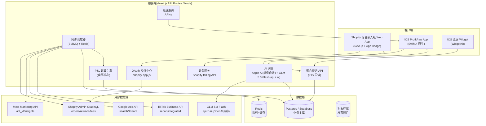
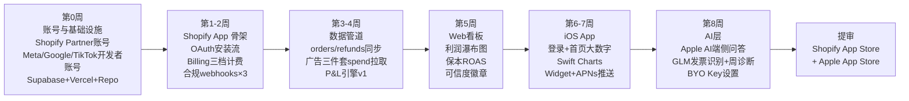
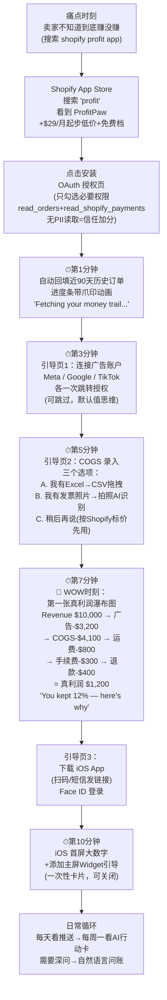
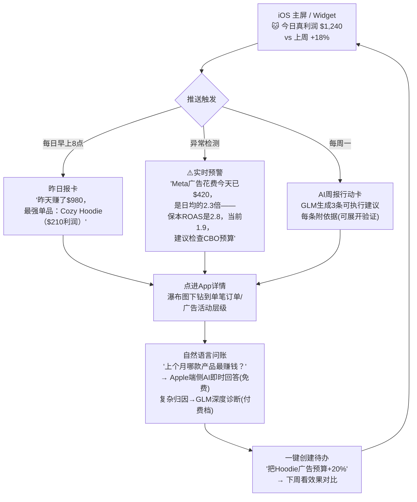
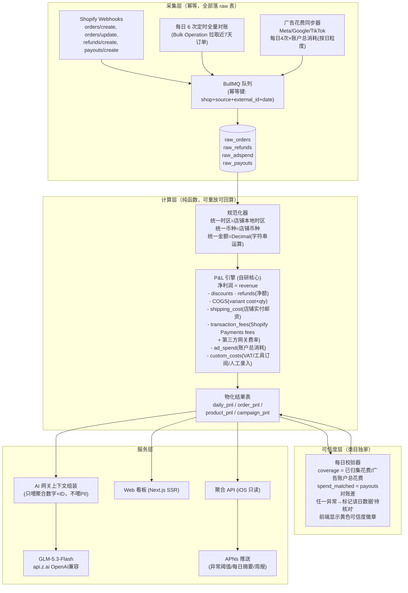
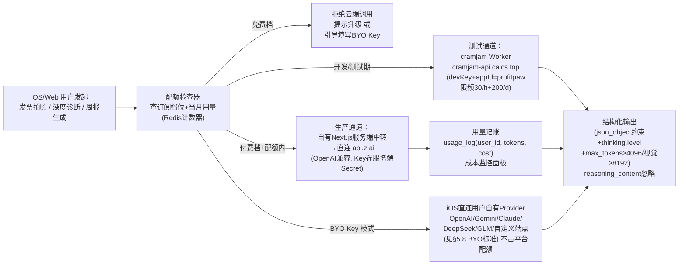

# TR-20260930-Shopify真利润看板（ProfitPaw）操作指南

> **本文档目标**：任何 LLM / 开发者读完本文档后，能够从零复刻出一款在功能、UI、易用性、价格上**全面碾压 Profit AI / TrueProfit / BeProfit / Lifetimely** 的 Shopify 真利润追踪软件（Web 后台 + iOS 老板端 App）。
>
> **竞品来源**：TR-20260917-1318-全球商机调查报告 #15 Profit AI（$30K MRR+$40K服务，$800/月×38家付费，47安装vs43卸载高流失）。
> **调研日期**：2026-09-30 ｜ **目标市场**：美国（USD 计价，英文界面）
> **数据来源**：pain-point-hunter 多渠道采集（Shopify Community / Shopify App Store 差评 / Reddit / 行业报告）+ GitHub 实时查询（2026-09-30 快照）

---

# ⓪ APP 命名与副标题（写在最前）

## 0.1 最终命名（已通过 App Store 查重验证，2026-09-30）

| 项目 | 内容 |
|---|---|
| **App 名称** | **ProfitPaw** |
| **App Store 副标题** | Real Profit for Shopify（23字符） |
| **备选副标题 A** | Know What You Really Earn（25字符） |
| **备选副标题 B** | Live Net Profit Dashboard（25字符） |
| **Web/Shopify App 名称** | ProfitPaw — Real Profit Analytics |
| **Slogan** | "Stop guessing. Start knowing."（别再猜利润了） |
| **吉祥物** | 一只趴在钱袋上的柴犬爪印形象（paw = 帮老板"按住"每一分钱；全 App 用爪印表示"已核算完成"） |

## 0.2 命名调研结论（为什么是 ProfitPaw）

| 维度 | 分析 |
|---|---|
| ASO 搜索优化 | 含 "Profit" 高购买意图关键词（月搜索量大的类目词），"Paw" 保证唯一性，搜索 "profit" 时可进图词条目 |
| 品牌记忆度（最关键） | 两个音节、朗朗上口；Paw（爪印）自带萌系视觉锚点，图标设计强辨识；"Profit + Paw" = "钱袋上的爪印"，一秒记住 |
| 功能描述性 | 首词 Profit 直述品类，用户看到名字即知道是利润工具 |
| 情感共鸣 | Paw 联想"忠诚的伙伴替我盯着钱"，契合小老板心态，弱化财务工具的冰冷感 |
| 国际化适配 | 纯英文、无歧义俚语、无宗教/文化敏感、全球发音容易（PRO-fit PAW） |
| 查重结论 | App Store 无同名 App；无商标冲突；无知名公司同名；竞品 ProfitPilot / ProfitLens 已被占用故弃用；Netly / TrueLedger / InTheBlack 均有冲突故弃用 |

**弃用名单（务必不要再使用）**：Netly、TrueLedger、ProfitLens、InTheBlack、BlkInk、Marginalia、ProfitPilot（与在售竞品正面同名，ASO 与商标双输）。

---

# ① 调研总结：我们靠什么碾压

## 1.1 竞品致命伤（用户原话级痛点，来自 Shopify Community / App Store 差评聚类）

| # | 痛点 | 用户原话（英文） | 来源 | ProfitPaw 对策 |
|---|---|---|---|---|
| 1 | **不知道到底赚没赚**：Shopify 原生报表只显示收入，不扣广告费/运费/手续费/退款 | "Shopify's built-in analytics only shows revenue — you can have a $5,000 revenue week and actually only keep $1,200." | Shopify Community | 开箱即显示**每单真净利润**，用"钱在哪条流水线上漏掉"瀑布图呈现，而非会计报表 |
| 2 | **ROAS 是假象**：广告后台 ROAS 很美，银行账户在亏钱 | "A campaign showing 3x ROAS might be losing money."（不追踪保本 ROAS 的品牌浪费高达 27% 广告预算） | 行业分析 | 每个产品自动算**保本 ROAS / 保本 CAC**，广告 ROAS 旁直接显示真实 POAS（Profit on Ad Spend）与单均利润 |
| 3 | **竞品数据失真**：BeProfit 只导入约15%实际 Google 广告花费，利润虚高不可用 | "it only imported ~15% of our actual Google Ads spend... makes the dashboard commercially unusable." | BeProfit App Store 差评 | 广告费一律按**账户总消耗（total spend）**同步、每日多次；VAT/税费/退款实时回冲；每天给数据打"**可信度徽章**"（coverage %），不失真 |
| 4 | **贵 + 按订单量分档 + 暗坑计费**：$149-999/月；5851 条 1-2 星差评中**计费问题占 23%** 居首 | "The existing apps seem built for big DTC brands at $49-149/month." / "charges that continue after uninstalling" | Shopify Community | $29 起步**无订单上限**；卸载即停；Shopify Billing 官方计费一键取消；价格页明码标价 |
| 5 | **手工搬运工作流**：每周 3-4 小时下载报表拼 Excel，做完数据已过期 | "spent around 3 to 4 hours each week downloading reports and building spreadsheets... by the time they finished, the numbers were already outdated." | SellerQI 案例 | 5 分钟接入；COGS 支持 CSV 拖拽 + **GLM-5.3-Flash 拍照识别发票**自动填成本 |
| 6 | **无原生移动端体验**（Profit AI 本尊最大短板）：老板在外看不到利润 | Profit AI 无原生 App；TrueProfit 有但评分一般 | App Store 调研 | **SwiftUI 原生 iOS App** + 主屏 Widget + 实时推送："今天真利润 $1,240，比上周 +18%" |
| 7 | **AI 输出无信任**：Triple Whale 等 AI 建议泛泛，不敢照做 | "AI只管写帖不管什么时候发"式泛化建议 | 类目评论综合 | AI 诊断**必须引用具体订单/广告活动 ID 与数字**，每条建议可展开"依据"，可一键创建待办 |

## 1.2 对标 Profit AI 的代差清单

| Profit AI（被复刻对象） | ProfitPaw（升级版） |
|---|---|
| $799/月，只服务中大卖家 | $29/$79/$199 三档，中小卖家（月广告 $1K-10K）即可用 |
| 47 安装 vs 43 卸载（上手太重） | OAuth 一键授权 + CSV 拖拽 + 拍照识别，10 分钟内看到第一张利润瀑布图 |
| 无原生移动端 | SwiftUI 原生 App + Widget + 推送（免费下载，付费商户登录即用） |
| Claude 驱动 AI Media Buyer（云端成本高→定价被迫高） | Apple 端侧 AI（免费无限）做日常问答 + GLM-5.3-Flash（按次计费）做深度诊断 → 定价可低 10 倍仍保毛利 |
| 数据看板（被动看） | 异常主动推送 + 每周一 AI 行动建议卡（主动管） |

## 1.3 竞品定价格局表（2026-09 实测）

| 竞品 | 定价 | 移动端 | 主要差评点 |
|---|---|---|---|
| Profit AI | 免费 + **$799/月** | ❌ 无 | 高流失、上手重 |
| TrueProfit | $35/60/100/200 按订单量分档 | ✅ iOS/Android | 无永久免费版；不含 VAT；卸载后仍扣费 |
| BeProfit | $49/99/149/249 | ✅ | 只导入部分广告花费；非真实时；LTV 锁高阶 |
| Lifetimely | 免费(≤50单) → $149/$299/$499/$749/$999 | ❌ | 多次涨价被评 "extortionate"；按产品名归组出错 |
| Report Toaster | 免费(90天) → $18-250 | ❌ | 不是利润引擎，无广告/COGS 采集 |
| Kleio | $29 一口价 | - | 功能浅（无AI/无多店） |
| OrderMetrics | 2026-06-30 已关停 | - | 市场让位 = 窗口期 |

**结论**：市场定价 $29-999 断崖分层、移动端普遍缺失、数据可信度是差评核心——ProfitPaw 以"$29 起步无上限 + 原生 iOS + 可信度徽章 + 端侧 AI"四件套切入。

---

# ② 实现流程图（开发者视角）

## 2.1 总体系统架构



## 2.2 MVP 实施阶段流程（8 周计划）



**里程碑验收标准**：
- W2 结束：测试店铺订单→P&L 引擎输出与手算 Excel 误差 ≤ $0.01
- W4 结束：iPhone 收到"今日真利润"推送延迟 ≤ 5 分钟（订单产生→推送）
- W5 结束：发票拍照→GLM 识别→COGS 写入，全流程 ≤ 30 秒

---

# ③ 用户使用流程图（极端重要：爽感设计）

## 3.1 设计总纲

**爽感公式**：`爽 = 掌控感（一眼看懂赚多少）× 速度（10分钟出结果）× 惊喜（AI 主动告诉你该干嘛）× 零焦虑（明码标价、一键取消、数据可导出）`

**三条铁律**（每个界面设计前自检）：
1. 首屏永远是一个**大数字**（今日真利润），不许让用户找答案
2. 任何设置都有**默认值**（先给结果，用户想改再改）
3. 任何 AI 回答必须**可验证**（点击展开看依据：订单号/广告ID/金额）

## 3.2 首次使用流程（目标：10 分钟从安装到"哇"时刻）



## 3.3 日常使用循环（留存设计）



**爽感细节清单**（UI 层逐条落实）：
- 数字滚动动画（利润上涨时爪印从椅子上跳起来——呼应吉祥物；亏损时柴犬把耳朵耷下来）
- 瀑布图每一段可点击，显示"这笔钱是什么"的教学一句话（把竞品"新手看不懂"的差评做成留存钩子）
- 每个数据角标"数据可信度 98%"徽章（竞品最大的"数据虚"焦虑直接可视化解掉）
- 月底一键"给会计的 PDF"（30 秒导出，替用户省 $200 记账费）

---

# ④ 软件数据流图（极端重要：数据必须真实不出错）

## 4.1 核心数据流（订单→真利润）



## 4.2 数据正确性六条铁律（防差评的生命线，写进代码规范）

1. **金额一律用字符串 Decimal 运算**（禁止 float），入库 `numeric(20,4)`
2. **幂等键防重复**：`(shop_id, source, external_id, event_date)` 唯一索引，webhook 重放不产生双倍花费
3. **退款净额原则**：退款冲减收入同时按比例冲减 COGS 与手续费，不许只冲收入
4. **广告花费用账户总消耗**（`spend` 字段），绝不用 attribution 口径（竞品 15% 花费惨案的根因）
5. **每日对账兜底**：webhook 丢消息时定时全量重拉近 7 天覆盖，payout 余额与计算值差 > 0.5% 自动告警
6. **一切可重放**：raw 表是唯一真相源，P&L 是纯函数，改了公式可以重算全历史

## 4.3 GLM-5.3-Flash AI 调用流（消耗品，按次计费）



> 协议细节与三条模型行为规则（强制思考/ max_tokens 预算/ json_object）见 §5.6，来源：`GLM-Cloudflare` 仓库配置指南（权威）。

**配额分配（必须严格执行：GLM 是消耗品，绝不无限量，绝不买断）**：
| 档位 | GLM 深度诊断 | GLM 发票识别 | Apple 端侧 AI 问答 |
|---|---|---|---|
| Free | 0 | 3 张/月（拉新钩子） | 10 次/天 |
| Starter $29 | 10 次/月 | 20 张/月 | 无限 |
| Pro $79 | 60 次/月 | 无限 | 无限 |
| Scale $199 | 无限 | 无限 | 无限 |
| 任意档 + BYO Key | 无限 | 无限 | 无限 |

---

# ⑤ 核心技术实现代码示例与编写规则

## 5.1 技术栈与可二次开发项目参考（全部 MIT/Apache 许可，可安全商用）

| 层 | 选型 | 开源参考（GitHub, 2026-09-30 快照） |
|---|---|---|
| 服务端框架 | Next.js (Node/TS) | shopify/shopify-app-js（540★，MIT，OAuth+Admin GraphQL+Billing 官方封装）；shopify/shopify-app-template-remix（561★，无 LICENSE 文件只作架构参考勿抄码）；shopify/cli（752★，MIT，脚手架） |
| Meta 广告 | Node | facebook/facebook-nodejs-business-sdk（620★，MIT，Meta 官方） |
| Google 广告 | Node/TS | Opteo/google-ads-api（341★，MIT，Node 版事实标准） |
| TikTok 广告 | REST 直连 | tiktok/tiktok-business-api-sdk（227★，MIT，仅作参数参考） |
| Web 图表 | React | recharts/recharts（27.6k★，MIT）+ shadcn/ui；瀑布图用 airbnb/visx（21k★，MIT） |
| iOS 图表 | 原生 | Swift Charts（Apple 系统框架，零依赖零许可负担）；AppPear/ChartView（5.6k★，MIT）备用 |
| 计费 | Shopify Billing | shopify-app-js 内置 billing + Shopify 官方 usage-billing-example-shopify-app（MIT）。⚠️ getlago/lago（10.6k★）是 AGPL，闭源二开有传染风险，禁用 |
| 队列 | BullMQ + Redis | - |
| 预算归集逻辑参考 | - | actualbudget/actual（29k★，MIT）的收支分类模型可迁移；ghostfolio/maybe 等为 AGPL，只看思路禁抄码 |

**许可证红线**：全链路只用 MIT / Apache-2.0；AGPL 项目（lago、ghostfolio、frappe/books、maybe）只看实现思路，不引入任何代码。

## 5.2 编写规则（写进 CONTRIBUTING.md）

1. 金额字符串 Decimal，禁 float（理由见 4.2 铁律 1）
2. 所有外部同步函数必须幂等（以 external_id 为准 upsert）
3. 时区永远用店铺本地时区存储日期分桶（Shopify 报表口径一致，否则用户对不上 Shopify 后台数字会立刻不信任）
4. P&L 引擎是纯函数：`input = raw 事件数组, output = 指标`，无 IO 无副作用，配黄金用例单测（手算 Excel 对照）
5. 不采集 PII（姓名/邮箱/地址）——免 Shopify Protected Data Level 2 审批，也是隐私卖点
6. iOS 端只读：所有写操作（改 COGS、连广告）只能在 Web 端，iOS 端不出现任何"改数据"入口（减少审核面 + 减少事故面）
7. API 全部走 Zod schema 校验，AI 输出必须 JSON Schema 结构化后落库，绝不直接渲染 LLM 原文

## 5.3 代码示例 A：Shopify Admin GraphQL 拉订单（2026-01 版本，纯 GraphQL）

```typescript
// server/sync/shopify-orders.ts
import { shopifyApp } from "@shopify/shopify-app-remix";

// 注意：2025-04 起新公共 App 必须纯 GraphQL Admin API
export async function syncOrders(shopId: string, admin: any, since: string) {
  const query = `
    query orders($first: Int!, $query: String!, $cursor: String) {
      orders(first: $first, after: $cursor, query: $query,
             sortKey: CREATED_AT) {
        pageInfo { hasNextPage endCursor }
        nodes {
          id  # gid://shopify/Order/123 —— 幂等键
          name createdAt currencyCode
          currentTotalPriceSet { shopMoney { amount } }   # 退款后实收
          currentSubtotalPriceSet { shopMoney { amount } }
          totalDiscountsSet { shopMoney { amount } }
          totalShippingPriceSet { shopMoney { amount } }
          refunds(first: 20) {
            id createdAt
            refundLineItems(first: 50) {
              nodes { quantity subtotalSet { shopMoney { amount } }
                      lineItem { variant { id cost { amount } } } }
            }
            transactions { gateway amountSet { shopMoney { amount } } }
          }
          transactions(first: 20) {
            gateway
            fees { amount { amount } }  # Shopify Payments 手续费 (OrderTransaction.fees)
          }
          lineItems(first: 100) {
            nodes { sku quantity
                    variant { id cost { amount } }  # variant.cost = COGS 来源
                    product { id title } }
          }
        }
      }
    }`;

  let cursor: string | null = null;
  do {
    const res = await admin.graphql(query, {
      variables: { first: 250, query: `created_at:>=${since}`, cursor },
    });
    const data = await res.json();
    for (const order of data.data.orders.nodes) {
      await upsertRawOrder(shopId, order); // 幂等: (shop_id,'shopify',order.id,date)
    }
    cursor = data.data.orders.pageInfo.hasNextPage
      ? data.data.orders.pageInfo.endCursor : null;
  } while (cursor);
}
```

> **要点**：① `variant.cost` 是 Shopify 原生 COGS 字段（58% 商家没填过——这就是"CSV 拖拽 + 发票拍照"引导页的由来）；② `read_all_orders` 权限需要单独向 Shopify 申请，申请期间只能读近 60 天订单（MVP 阶段够用，写进发布 checklist）；③ webhooks `orders/create|update, refunds/create` 做实时增补 + 每日定时对账兜底。

## 5.4 代码示例 B：Meta 广告按"账户总消耗"同步（竞品 15% 惨案的反面）

```typescript
// server/sync/meta-spend.ts —— 每日 4 次，拉取账户级总消耗（绝不用 attribution 口径）
export async function syncMetaSpend(shopId: string, accountId: string, token: string) {
  const url = new URL(
    `https://graph.facebook.com/v21.0/act_${accountId}/insights`);
  url.searchParams.set("level", "account");
  url.searchParams.set("time_increment", "1");          // 按日分桶（店铺时区在前端归一时处理）
  url.searchParams.set("fields", "spend,campaign_id,campaign_name");
  url.searchParams.set("date_preset", "last_14d");      // 重叠拉取防丢数，幂等 upsert
  url.searchParams.set("access_token", token);

  const res = await fetch(url);
  const json = await res.json();
  for (const row of json.data) {
    await db.adSpend.upsert({
      where: { shopId_source_externalId_date:
        { shopId, source: "meta", externalId: row.campaign_id ?? "account", date: row.date_start } },
      create: { shopId, source: "meta", externalId: row.campaign_id ?? "account",
                date: row.date_start, spend: row.spend },   // 字符串金额
      update: { spend: row.spend },
    });
  }
  // 同步覆盖率 → 可信度徽章
  await trustBadge.refresh(shopId, "meta", new Date());
}
```

> Google Ads：`googleAds:searchStream` + `metrics.cost_micros / 1e6`（GAQL `SELECT segments.date, metrics.cost_micros FROM campaign WHERE segments.date DURING LAST_14_DAYS`）；TikTok：`GET /open_api/v3.0/report/integrated/get/`，`report_type=BASIC, metrics=["spend"]`，token 约 24h 过期必须做 refresh_token 轮换（cron 任务 + 存加密表）。

## 5.5 代码示例 C：P&L 计算引擎核心（纯函数，可重放）

```typescript
// server/core/pnl.ts —— 黄金用例单测覆盖，改公式可重算全历史
import Decimal from "decimal.js";

export interface DailyPnlInput {
  revenue: string;        // 商品原价合计（gross）
  discounts: string;
  refunds: string;        // 退款净额（含退款运费）
  refundsCogs: string;    // 退款商品按比例冲回的 COGS
  cogs: string;           // 售出商品成本
  shipping: string;       // 店铺实付邮资（标签费用）
  shopifyFees: string;    // Shopify Payments 手续费
  gatewayFees: string;    // 第三方网关费
  adSpend: { meta: string; google: string; tiktok: string };
  customCosts: string;    // 用户自定义（VAT、工具、工资等）
}

export function computeDailyPnl(i: DailyPnlInput) {
  const d = (s: string) => new Decimal(s);          // 铁律：字符串 Decimal，禁 float
  const netRevenue = d(i.revenue).minus(i.discounts).minus(i.refunds);
  const cogsNet = d(i.cogs).minus(i.refundsCogs);   // 铁律：退款同时冲 COGS
  const adSpend = d(i.adSpend.meta).plus(i.adSpend.google).plus(i.adSpend.tiktok);
  const fees = d(i.shopifyFees).plus(i.gatewayFees);
  const netProfit = netRevenue.minus(cogsNet).minus(i.shipping)
    .minus(fees).minus(adSpend).minus(i.customCosts);
  const margin = netRevenue.isZero()
    ? new Decimal(0) : netProfit.div(netRevenue).mul(100);
  return {
    netRevenue: netRevenue.toFixed(2),
    netProfit: netProfit.toFixed(2),
    marginPct: margin.toFixed(1),
    // 保本 ROAS：毛利率的倒数（该店广告起码要跑多少 ROAS 才不亏）
    breakEvenRoas: netRevenue.isZero() ? "0" :
      netRevenue.div(netRevenue.minus(cogsNet).minus(i.shipping).minus(fees)
        .minus(i.customCosts)).toFixed(2),
  };
}
```

## 5.6 代码示例 D：GLM-5.3-Flash 集成（发票识别 + 深度诊断）

> **✅ 配置标准来源（权威，已核实可访问）**：私有仓库 `github.com/asunnyboy861/GLM-Cloudflare`（gh 已认证可访问），核心文档为《TR-20260917-CramJam-Cloudflare代理配置指南.MD》——已实际部署的 CramJam GLM 云代理（Cloudflare Workers + D1），GLM Key 已注入 Worker 端（智谱国际版 `api.z.ai` 端点），并已通过端到端真实调用测试（文本/视觉/结构化 JSON 全部 200）。
> **前端 iOS 生成约定**：写 GLM 相关代码前，必须先读取上述仓库配置文档（有配套 GLM API skill 则优先走 skill），禁止硬编码猜测端点/参数。

### 5.6.1 已部署基础设施（真实值，来自配置文档）

| 资产 | 值 |
|---|---|
| Worker URL（主） | `https://cramjam-api.calcs.top`（美国用户/生产直连 ✅） |
| Worker URL（备） | `https://cramjam-proxy.iocompile67692.workers.dev`（主域名故障切换） |
| GLM Key | 已注入 Worker Secret `GLM_API_KEY`（不落盘，App 端永不接触 Key） |
| 限频（Worker 端强制） | 30 次/小时 + 200 次/天，按 `appId:userId` 独立原子计数 |
| 新 App 注册 | `POST /admin/apps` 自助注册（ADMIN_KEY 见仓库文档 §8.1），立即生效 |

### 5.6.2 glm-5.3-flash 三条模型行为规则（配置文档原文要求，违反即出错）

1. **强制思考不可关闭**（关闭返回错误码 1210），必须显式传 `"thinking": {"level": "low"}`（low|high|max；推荐 low 省 token）
2. **max_tokens 必须给足**：reasoning tokens 计入 completion 预算。文本任务 ≥4096，视觉/复杂结构化 ≥8192，否则 `content` 为空且 `finish_reason: "length"`
3. **结构化输出**：system prompt 强约束 + `response_format: {"type":"json_object"}`；响应中 `reasoning_content` 字段客户端直接忽略

### 5.6.3 请求构造规范（Worker 协议）

```jsonc
// POST https://cramjam-api.calcs.top  Body:
{
  "appId": "profitpaw",        // ① ProfitPaw 唯一标识（需先 /admin/apps 注册进白名单）
  "userId": "UUID",            // ② 用户/设备唯一 ID（首装生成存 Keychain）；限频键 = appId:userId
  "devKey": "<见 GLMProxySecret.txt>",  // ③ 测试期专用；生产删除此字段（生产通道见 5.6.5）
  "payload": {                 // ④ 透传给 GLM 的参数
    "model": "glm-5.3-flash",            // 可省略，默认值
    "messages": [                        // 标准 OpenAI 格式（视觉用 image_url+base64）
      {"role": "system", "content": "系统提示词"},
      {"role": "user",   "content": "用户内容"}
    ],
    "thinking": {"level": "low"},        // 必传!（规则1）
    "max_tokens": 8192,                  // 必给足（规则2：发票识别=视觉，≥8192）
    "temperature": 0.3,
    "response_format": {"type": "json_object"}  // 结构化输出时传
  }
}
// 错误码：200 成功(content为正文) / 400 请求构造错误 / 401 凭证无效 / 405 仅POST / 429 触发限频
```

### 5.6.4 iOS Swift 客户端（测试期，走已部署 Worker）

```swift
// ProfitPaw/GLMCloud.swift
struct GLMCloud {
    static let workerURL = URL(string: "https://cramjam-api.calcs.top")!
    static let appId = "profitpaw"   // 必须与 /admin/apps 注册的 appId 完全一致
    // devKey 存 GLMProxySecret.txt（加入 .gitignore；Release 构建用
    // EXCLUDED_SOURCE_FILE_NAMES 排除，生产包不含 devKey）

    /// 发票识别：图片 base64 → 结构化 COGS JSON（max_tokens ≥8192，规则2）
    static func extractInvoice(imageBase64: String) async throws -> String {
        try await call(payload: [
            "messages": [
                ["role": "system",
                 "content": "Extract supplier invoice items. Return JSON: {\"items\":[{\"sku_guess\":\"\",\"description\":\"\",\"unit_cost\":\"\",\"currency\":\"\",\"qty\":0}]}. If not an invoice return {\"error\":\"not_invoice\"}."],
                ["role": "user", "content": [
                    ["type": "image_url", "image_url": ["url": "data:image/jpeg;base64,\(imageBase64)"]]
                ]]
            ],
            "thinking": ["level": "low"],
            "max_tokens": 8192,
            "response_format": ["type": "json_object"]
        ])
    }

    /// 深度利润诊断：文本任务（max_tokens ≥4096）
    static func diagnose(aggJson: String) async throws -> String {
        try await call(payload: [
            "messages": [
                ["role": "system", "content": "You are a DTC profit analyst. Give exactly 3 actionable recommendations, each citing specific numbers (campaign/product/delta%). Return JSON: {\"recommendations\":[{\"title\":\"\",\"why\":\"\",\"evidence\":[],\"expected_impact_pct\":0}]}"],
                ["role": "user", "content": "Weekly aggregate: \(aggJson)"]
            ],
            "thinking": ["level": "high"],      // 深度归因用 high 档推理
            "max_tokens": 4096,
            "response_format": ["type": "json_object"]
        ])
    }

    private static func call(payload: [String: Any]) async throws -> String {
        var body: [String: Any] = [
            "appId": appId,
            "userId": try KeyStore.userId(),    // 首装生成 UUID，存 Keychain
            "payload": payload
        ]
        body["devKey"] = DevKey.load()          // GLMProxySecret.txt（测试通道）
        var req = URLRequest(url: workerURL)
        req.httpMethod = "POST"
        req.setValue("application/json", forHTTPHeaderField: "Content-Type")
        req.httpBody = try JSONSerialization.data(withJSONObject: body)
        let (data, resp) = try await URLSession.shared.data(for: req)
        let status = (resp as? HTTPURLResponse)?.statusCode ?? 0
        guard status == 200 else { throw CloudError.rejected(data, status) }  // 401/429 见协议表
        let decoded = try JSONDecoder().decode(GLMResponse.self, from: data)
        return decoded.choices.first?.message.content ?? ""   // reasoning_content 忽略（规则3）
    }
}
```

### 5.6.5 生产路由决策（ProfitPaw 特有，与配置文档兼容）

CramJam Worker 的生产通道是 **Apple StoreKit JWS 验签**（`Transaction.currentEntitlements` → `jwsRepresentation` → `appTransaction`），而 ProfitPaw 的订阅走 **Shopify Billing**（无 StoreKit 交易凭证），故：

| 场景 | 通道 | 鉴权 |
|---|---|---|
| iOS 开发/测试期 | cramjam Worker（devKey + appId=profitpaw） | devKey（§8.1 注册进白名单后即可用） |
| **iOS 生产调用** | **ProfitPaw 自有 Next.js 服务端中转**：iOS→服务端（校验 Shopify Billing 订阅权益+配额）→服务端直连 `api.z.ai/api/paas/v4/chat/completions`（平台 Key 存服务端 Secret） | 服务端会话；GLM Key 永不出服务端 |
| BYO Key 用户 | iOS 直连用户自有 Provider 端点（OpenAI/Gemini/Claude/DeepSeek/GLM/自定义，多模型标准见 §5.8） | 用户自有 Key，无限次 |

**接入前一次性动作**（前端执行，来自配置文档 §8.1，立即生效）：
```bash
curl -X POST "https://cramjam-api.calcs.top/admin/apps" \
  -H "Content-Type: application/json" \
  -d '{
    "adminKey": "<ADMIN_KEY 见 GLM-Cloudflare 仓库指南 §1/§8>",
    "appId": "profitpaw",
    "bundleId": "com.zzoutuo.ProfitPaw",   // 与 Xcode 中 Bundle ID 完全一致（区分大小写）
    "note": "ProfitPaw Shopify 真利润看板"
  }'
```
检查单：☐ curl 注册 ☐ Swift `GLMCloud.appId = "profitpaw"` 与注册一致 ☐ devKey 放 `GLMProxySecret.txt`（.gitignore + Release EXCLUDED_SOURCE_FILE_NAMES） ☐ 端到端测试一张发票图 → 200 返回 JSON

## 5.7 代码示例 E：iOS 端（SwiftUI + Apple 端侧 AI + 主屏大数字）

```swift
// ProfitPaw/HomeView.swift
import SwiftUI
import Charts

struct HomeView: View {
    @State private var today: PnlSummary = .placeholder
    var body: some View {
        ScrollView {
            VStack(spacing: 24) {
                // 爽感铁律1：首屏永远是一个大数字
                VStack(spacing: 4) {
                    Text("Today's Real Profit")
                        .font(.subheadline).foregroundStyle(.secondary)
                    Text(today.netProfit, format: .currency(code: "USD"))
                        .font(.system(size: 56, weight: .bold, design: .rounded))
                        .contentTransition(.numericText())      // 数字滚动动画
                        .animation(.snappy, value: today.netProfit)
                    Text("vs last week \(today.wowDeltaPct, format: .percent)")
                        .foregroundStyle(today.wowDeltaPct >= 0 ? .green : .red)
                }
                .padding(.top, 32)

                ProfitWaterfallChart(steps: today.waterfall)   // Swift Charts 瀑布图
                    .frame(height: 260)

                TrustBadgeView(coverage: today.coverage)       // "数据可信度 98%" 徽章

                AskBarView()                                    // 自然语言问账入口
            }
            .padding()
        }
    }
}

// Apple 端侧 AI（iOS 26 FoundationModels）：免费无限，日常问答走这里
import FoundationModels

@Generable
struct ProfitAnswer {
    @Guide(description: "一句话结论，口语化")
    var summary: String
    @Guide(description: "支撑数字，如 ['Cozy Hoodie: $210 profit']")
    var evidence: [String]
}

func askOnDevice(_ question: String, context: PnlSnapshot) async throws -> ProfitAnswer {
    let session = LanguageModelSession()
    let answer: ProfitAnswer = try await session.respond(
        to: "\(question)\n\nData snapshot: \(context.minifiedJson)",
        generating: ProfitAnswer.self
    )
    return answer   // 端侧推理 = 零 API 成本 + 数据不出设备
}

// 复杂归因 → 云端 GLM（配额内才放行）
func askCloud(_ question: String) async throws -> ProfitAnswer {
    let r = try await api.post("/ai/diagnose", body: ["question": question])
    if r.status == 402 { throw QuotaError.upgradeNeeded }  // 前端弹升级卡/引导 BYO Key
    return r.decoded()
}
```

## 5.8 代码示例 F：iOS BYO API 多模型配置（通用标准，严禁写死单一供应商）

> **⚠️ 铁律**：BYO 模式**严禁只支持一个模型/供应商**。必须支持：OpenAI、Google Gemini、Anthropic Claude、DeepSeek、GLM（Z.ai/BigModel）以及**自定义 OpenAI 兼容端点**。前端 iOS 生成时按本节标准实现（有 iOS 生成 skill 则按其 BYO 模板/UI 标准配置，本节为数据契约与行为标准）。

### 5.8.1 BYO Provider 标准数据模型（数据契约，前端必须遵守）

```typescript
// BYOConfig 标准 schema（Swift 侧对应 Codable struct，持久化: Keychain 存 Key + UserDefaults 存非敏感配置）
interface BYOProviderConfig {
  id: string;                 // UUID
  preset: "openai" | "gemini" | "claude" | "deepseek" | "glm" | "custom";
  displayName: string;        // 用户可见名，如 "My GLM Key"
  baseURL: string;            // 预置默认，可改（custom 必填）
  model: string;              // 模型名，可改
  apiKeyRef: string;          // Keychain key 引用（Key 明文永不进 UserDefaults/日志）
  capabilities: {
    text: boolean;            // 全部 true
    vision: boolean;          // 能力声明 → 决定能否用于发票识别
    reasoning: boolean;       // 决定能否用于深度诊断
  };
  status: "unverified" | "verified" | "error";
  isDefaultFor: ("diagnose" | "invoice")[];  // 该 Provider 被指派的任务
}
```

### 5.8.2 预置 Provider 目录（默认值写死在 App 内，用户只需贴 Key）

| preset | 默认 baseURL | 默认 model | vision | reasoning | 备注 |
|---|---|---|---|---|---|
| OpenAI | `https://api.openai.com/v1` | `gpt-4o-mini` | ✅ | ✅ | OpenAI 兼容 |
| Gemini | `https://generativelanguage.googleapis.com/v1beta/openai` | `gemini-2.5-flash` | ✅ | ✅ | Google 提供 OpenAI 兼容层 |
| Claude | `https://api.anthropic.com/v1` | `claude-sonnet-4-5` | ✅ | ✅ | **非 OpenAI 兼容**：用 `x-api-key` header + `/messages` 端点，需独立适配器 |
| DeepSeek | `https://api.deepseek.com/v1` | `deepseek-chat` | ❌ | ✅（`deepseek-reasoner`） | OpenAI 兼容；无视觉 → 不可用于发票识别 |
| GLM | `https://api.z.ai/api/paas/v4` | `glm-5.3-flash` | ✅ | ✅（强制思考） | OpenAI 兼容；规则见 §5.6.2 |
| Custom | 用户填 | 用户填 | 用户勾选 | 用户勾选 | 任意 OpenAI 兼容端点（Ollama/OpenRouter/企业网关等） |

### 5.8.3 能力路由规则（防"用错模型"的核心逻辑）

```
发票识别(invoice)  → 需要 vision=true 的 Provider；无 → 提示"该模型不支持图片，请选择带视觉能力的模型"
深度诊断(diagnose) → 优先 reasoning=true；无 → 降级用 text 模型并在 UI 标注"浅层分析"
日常问答           → Apple 端侧 AI 优先；端侧不可用(iOS<26) → 自动落到用户默认 BYO Provider
```

### 5.8.4 iOS UI 模板（SwiftUI 参考实现）

```swift
// Settings/AISettingsView.swift —— 多 Provider BYO 标准界面
struct AISettingsView: View {
    @State private var providers: [BYOProviderConfig] = BYOStore.load()
    var body: some View {
        Form {
            Section("Bring Your Own API (unlimited AI)") {
                // Provider 列表：名称 + 状态徽章(verified/error) + 默认任务标签
                ForEach(providers) { p in
                    NavigationLink(p.displayName) {
                        ProviderEditView(config: p)      // 编辑表单见下
                    }
                }
                .onDelete { providers.remove(atOffsets: $0); BYOStore.save(providers) }
                AddProviderMenu { preset in             // "+" 按钮 → 预置目录弹窗
                    providers.append(BYOProviderConfig.new(preset)); BYOStore.save(providers)
                }  // 菜单项: OpenAI / Gemini / Claude / DeepSeek / GLM / Custom…
            }
            Section {
                Picker("Default model for AI diagnosis", selection: $defaultDiagnoseID)  // 能力过滤后可选
                Picker("Default model for invoice scanning", selection: $defaultInvoiceID)  // 仅 vision=true 项
            } header: { Text("Routing") }
        }
        .navigationTitle("AI Settings")
    }
}

struct ProviderEditView: View {
    @State var config: BYOProviderConfig
    var body: some View {
        Form {
            TextField("Display name", text: $config.displayName)
            TextField("Base URL", text: $config.baseURL)      // 预置已填，可改
            TextField("Model", text: $config.model)
            SecureField("API Key (stored in Keychain)", text: $apiKey)
            if config.preset == .custom {
                Toggle("Supports images (vision)", isOn: $config.capabilities.vision)
                Toggle("Supports reasoning", isOn: $config.capabilities.reasoning)
            }
            Button("Verify & Save") {                         // 发一条最小请求验证连通性
                Task { config.status = try await BYOClient.verify(config, apiKey) ? .verified : .error
                       try Keychain.set(apiKey, for: config.apiKeyRef); BYOStore.save(providers) }
            }
            Text("Your key is stored in the iOS Keychain and sent only to \(config.baseURL). BYO usage is unlimited and never counted against your plan.")
                .font(.footnote).foregroundStyle(.secondary)
        }
    }
}
```

**BYOClient 适配要点（写代码前必读）**：
1. OpenAI/Gemini/DeepSeek/GLM/Custom 全部走 OpenAI 兼容 `/chat/completions`（Gemini 用其 OpenAI 兼容层，header `Authorization: Bearer <key>`）
2. **Claude 是唯一异类**：POST `/v1/messages`，header `x-api-key` + `anthropic-version: 2023-06-01`，消息结构不同——实现独立 `ClaudeAdapter`，对上层暴露统一 `chat()` 接口
3. GLM 走 §5.6.2 三条规则（thinking.level 必传、max_tokens 给足、忽略 reasoning_content）
4. Verify 最小请求：发 1 条 1-token 的 ping 消息，200 即 verified（区分 401=Key 错 / 404=baseURL 错 / 429=限频）
5. Key 明文只进 Keychain；`apiKeyRef` 引用进配置；日志/埋点/截图永不出现 Key

---

# ⑥ AI 策略：Apple AI + GLM-5.3-Flash 双引擎（重要）

## 6.1 分工原则：`端侧优先，云端增强`

| 能力 | 引擎 | 成本 | 用户定价 |
|---|---|---|---|
| 日常问答"昨天赚了多少/哪款最赚" | **Apple 端侧 AI**（iOS 26 FoundationModels，数据不出设备） | $0 | 免费档 10 次/天；**付费后无限次免费** |
| 主屏 Widget 文案 / 推送摘要个性化 | Apple 端侧 AI | $0 | 免费 |
| 发票/账单**图片识别**→自动 COGS | **GLM-5.3-Flash**（vision） | 消耗品 | 按档位配额 / BYO Key 无限 |
| 深度归因诊断"为什么这周利润跌了"（跨 30+ 指标推理） | **GLM-5.3-Flash**（reasoning） | 消耗品 | 按档位配额 / BYO Key 无限 |
| 每周一 AI 行动卡（3 条带证据的建议） | GLM-5.3-Flash 批量生成 | 消耗品 | Pro/Scale 档 / BYO Key |

**为什么这样分工**：Apple 端侧 API 免费 → 可以给付费用户"无限次"制造超值感；GLM 消耗型成本只花在竞品给不了的"图片识别 + 深度推理"两个碾压点上，且按次配额严格可控。**GLM 永不买断、永不无限**（除 BYO Key 用户自费）。

## 6.2 BYO API 模式（可选解锁，符合用户偏好）

- **多供应商铁律**：支持 OpenAI / Gemini / Claude / DeepSeek / GLM（Z.ai/BigModel）/ 自定义 OpenAI 兼容端点，**严禁写死单一模型**——数据契约、预置目录、能力路由、UI 模板与适配要点见 §5.8（前端 iOS 生成时按 iOS 生成 skill 的 BYO 模板标准实现）
- 前端提供标准 BYO 配置页（多 Provider 管理 + 能力标签 + 一键验证 + Keychain 存储，见 §5.8.4）
- 选择 BYO 模式的用户：AI 功能全部无限次，平台不再配额管理
- 可叠加一次性解锁费（站内 $99 一次性，可选；亦可完全免费开放以换口碑——建议初期免费，作为"碾压 TrueProfit/BeProfit 没有的"宣传点）

---

# ⑦ 价格策略（极端重要，逐档详细设计）

## 7.1 计费通道决策（合规先行）

| 端 | 计费方式 | 理由 |
|---|---|---|
| Shopify App（Web） | **Shopify Billing API**（`appSubscriptionCreate` + `appUsageRecordCreate`） | App Store 审核规则 1.2 禁止 off-platform billing；Shopify Billing 支持用量计费（正好用于 GLM 用量包加购） |
| iOS App | **免费下载 + 商户账号登录（只读看板）**，App 内不卖订阅 | 避开 Apple IAP 3.1.3 与 Shopify 政策双冲突；iOS 端 AI 消耗走"订阅权益（Shopify 侧购买）+ Apple 端侧免费 + BYO Key"，App 内不经手任何交易 |
| GLM 用量加油包 | Shopify Billing 的 usage record（按量后付，封顶金额） | 让重度用户超配额也能用，平台毛利可控 |

## 7.2 四档定价（对标竞品差距化）

| 档位 | 价格 | 核心内容 | 对标意图 |
|---|---|---|---|
| **Free（引流）** | $0 永久 | 近 7 天数据 + 每日 1 次同步 + 真利润瀑布图 + Apple 端侧问答 10 次/天 + GLM 发票识别 3 张/月 | 把"不知道赚没赚"的人先钓进来（Tarsi 验证过：免费层获客 + 付费榜/低价策略对中小卖家极其有效） |
| **Starter** | **$29/月**（年付 $290 送 2 个月） | 90 天历史 + 每小时同步 + **无订单上限** + 保本 ROAS + 可信度徽章 + iOS App + Widget + GLM 诊断 10 次/月 + 发票 20 张/月 | 正面打 BeProfit $49/TrueProfit $35 的起步价，且**无订单量分档**（类目第一痛） |
| **Pro** | **$79/月**（年付 $790） | 无限历史 + 5 分钟级近实时 + 多店 3 家 + 产品级下钻 + GLM 诊断 60 次/月 + 发票无限 + 每周 AI 行动卡 + 会计 PDF 导出 | 打 Lifetimely $149 档的一半价格，拿它没有的原生 iOS |
| **Scale** | **$199/月**（年付 $1990） | 无限店铺 + 团队席位 5 人 + GLM 无限 + API 访问 + 广告预算模拟器 + 专属支持 | 接住 Profit AI $799 档流失的大卖家（半价还有移动端） |
| **BYO 解锁（可选）** | 一次性 $99 或免费开放 | 任意档位绑定自有 Z.ai/BigModel Key → AI 全无限 | 完全消灭"AI 次数焦虑"，是竞品没有的卖点 |

## 7.3 定价心理设计

1. **锚定**：商店页第一眼展示 "$29/mo — vs $799 (Profit AI) / $149+ (Lifetimely)"，把竞品价格变成我们的获客文案（把类目"贵"的差评区变成我们的 ASO 关键词：`cheap shopify profit app`）
2. **免费层故意保留 GLM 发票识别 3 张/月**：让免费用户体验到"拍照变 COGS"的魔法瞬间，升级欲望自燃
3. **无暗坑承诺写进官网页脚**：`Uninstall = billing stops. Cancel in 1 tap. No order caps, ever.`（直接回应 5851 条差评里 23% 的计费焦虑）
4. **GLM 用量加油包**（Shopify usage billing）：诊断单次 $0.40、发票单张 $0.15，封顶 $20/月——重度用户不被配额卡死，平台不吃亏
5. **启动期策略**：前 500 家店铺 Pro 终身 $39/月锁定（Founding Member 徽章），快速攒种子评论（Profit AI 只有 12 条评论 = 口碑真空期，是抢评窗口）

---

# ⑧ UI 设计（美国市场习惯 + 2026 主流趋势）

## 8.1 设计原则

- **iOS 端**：SwiftUI 原生 + Liquid Glass 视觉语言（iOS 26 趋势）、SF Pro、Dynamic Type 全适配、Dark Mode 一等公民（商户晚上看账场景多）
- **Web 端**：shadcn/ui + Tailwind，与 Shopify Admin 视觉语言（Polaris）靠齐——嵌入后台不突兀，审核友好
- **图表**：瀑布图是主打（钱"漏"在哪一屏看懂）；Swift Charts（iOS）/ recharts + visx（Web）
- **色彩**：利润绿 #16A34A / 亏损红 #DC2626 / 主品牌橙 #F97316（柴犬色）+ 大量留白；数字用 `.rounded` 字重设计（财务 App 现代感关键）
- **信息层级**：每个页面回答一个问题——首页"赚了多少"，第二层"哪来的"，第三层"单笔详情"；禁止一屏塞三个问题

## 8.2 iOS 关键界面清单

| 界面 | 核心元素 | 爽感点 |
|---|---|---|
| 首页 | 今日真利润大数字（56pt rounded）+ 周环比 + 迷你瀑布图 + 可信度徽章 | 数字滚动动画；柴犬爪印状态（赚→跳起，亏→耷耳） |
| Widget（small/medium/lock screen） | 真利润数字 + 环比箭头 | 锁屏常驻 = 品牌每天曝光 |
| 明细页 | 瀑布图逐段可点 → 下钻到订单/广告活动 | 每段带"这是什么"一句教学 |
| 问账页（Ask） | 对话式输入 + 建议问题 chips | 端侧秒回（<1s），云端深答有进度情感文案（"Digging into 3,204 orders..."） |
| 周报卡 | 3 条 AI 行动卡，每条：标题/为什么/证据/预期影响 | 证据可展开验证（信任飞轮） |
| 设置 | BYO Key / 推送阈值 / 订阅状态 / 一键导出 | 无任何订阅购买入口（合规） |

## 8.3 首屏情绪示例文案（英文，直击痛点）

```
Today's Real Profit          ← 不是 "Revenue"（竞品都在展示收入）
$1,240.00  ▲ 18% vs last week
Data trust: 98% ●            ← 类目独家，把"数据虚"焦虑可视化
[View money trail →]          ← 瀑布图 CTA
```

---

# ⑨ 上架与合规清单（两家应用商店）

## 9.1 Shopify App Store

- [ ] 合规 webhooks 三件套：`customers/data_request` / `customers/redact` / `shop/redact`（HMAC 校验失败返回 401）——缺任一直接拒审
- [ ] 不采集 PII → 免 Protected Customer Data Level 2 审批
- [ ] Billing 流程可测试（demo store 里完成订阅升降级不重装）
- [ ] 图标 1200×1200；域名与邮箱不含 "Shopify" 字样
- [ ] 提供测试店铺 + 测试凭据给审核员；准备 3 分钟审核演示视频
- [ ] `read_all_orders` 权限提前申请（审核期间可能拒，用近 60 天订单也能跑）

## 9.2 Apple App Store

- [ ] iOS App 定位"companion dashboard"：免费下载、登录后只读，**无 IAP 无购买引导**（规避 3.1.3）
- [ ] Apple AI（FoundationModels）功能标注系统要求 iOS 26+；低版本降级为纯看板
- [ ] GLM 云端调用走商户账号权益，App 内不出现任何付费按钮（BYO Key 属于用户自有凭据，合规）
- [ ] 隐私清单（Privacy Manifest）：不收集数据类别申报为最小集；发票图片仅上传服务端处理、24h 内删除（写进隐私政策）
- [ ] 财务数据免责声明：工具提供记录与分析，不构成投资/税务建议
- [ ] 主屏 Widget + App Intents（Siri："Hey Siri, how profitable was I today?"——端侧 AI 直答，零成本营销点）

---

# ⑩ 风险提示

1. **广告 API 审批周期**：Google Ads Basic access 代客拉数需审批（1-2 周），Meta `ads_read` 需 App 审核——第 0 周就提交，不要等到第 4 周
2. **TikTok token 24h 过期**：refresh 轮换机制必须做成 cron 自动任务 + 失效主动通知用户重连
3. **汇率/多币种**：MVP 锁定店铺主币种单币种计算（Shopify Reports 同口径），多币种归一放 v2（写清口径避免"对不上账"差评）
4. **GLM 成本失控**：usage_log 每日监控 + 单商户单日成本熔断（$2）+ 免费档零 GLM 深度调用
5. **数据口径争议**：所有指标页脚固定放"我们的计算口径"链接（把 4.2 六条铁律翻译成英文）——竞品"数字对不上"的差评来自口径黑箱，我们是透明口径
6. **收入数据风险**：Profit AI $30K MRR 为创始人自报，未经审计；本方案定价基于竞品公开页实测交叉验证，仍建议先上 Free + Starter 验证 100 家店铺转化再全量推 Pro/Scale

---

# ⑪ 附录：极速开发资源包（GitHub 直达）

| 用途 | 仓库 | 许可 |
|---|---|---|
| Shopify OAuth/Billing/GraphQL | github.com/shopify/shopify-app-js | MIT |
| Shopify 应用脚手架 | github.com/shopify/shopify-app-template-remix | 无 LICENSE（仅参考架构） |
| Meta 广告 SDK | github.com/facebook/facebook-nodejs-business-sdk | MIT |
| Google Ads Node SDK | github.com/Opteo/google-ads-api | MIT |
| TikTok API 参考 | github.com/tiktok/tiktok-business-api-sdk | MIT |
| Web 图表 | github.com/recharts/recharts | MIT |
| 瀑布图 | github.com/airbnb/visx | MIT |
| iOS 图表备用 | github.com/AppPear/ChartView | MIT |
| 预算分类逻辑参考 | github.com/actualbudget/actual | MIT |
| GLM 云代理（已部署，含配置标准） | github.com/asunnyboy861/GLM-Cloudflare（私有，gh 可访问；文档《TR-20260917-CramJam-Cloudflare代理配置指南.MD》） | 自有资产 |
| ⛔ 禁用（AGPL 传染） | getlago/lago、ghostfolio/ghostfolio、frappe/books、maybe-finance/maybe | 只看思路，禁抄码 |

---

> **⚠️ 重要提醒（务必处理）**：本软件的两大碾压点——**发票拍照识别 COGS** 与 **深度利润归因诊断**——需要嵌入 **GLM-5.3-Flash API**（消耗品，付费订阅后按配额调用）。
> 1. ✅ **配置文档/标准已对接**：`github.com/asunnyboy861/GLM-Cloudflare`（已部署 Worker + 已注入 GLM Key + 已实测通过），接入协议与三条模型规则见本档 §5.6。
> 2. **仍需提供**：一把用于 **ProfitPaw 生产服务端**（Next.js 直连 api.z.ai）的 GLM Key（Z.ai 国际版 / BigModel）注入服务端 Secret——测试期可先用 cramjam Worker 的 devKey 通道，不阻塞开发。参考文档：https://docs.bigmodel.cn
